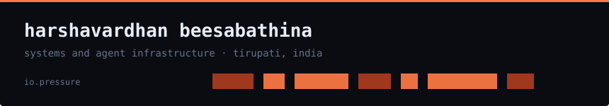
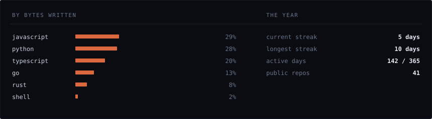

[antharmaya.com](https://antharmaya.com) · [linkedin](https://linkedin.com/in/varbees) · [email](mailto:harshavar968@gmail.com)

> Self-taught into systems from the web side. Small tools that do one thing
> completely, over frameworks that do everything badly.

I direct a multi-agent workforce to build production software, and I review
everything it writes. That habit is the whole job — it's why I can point at
783 passing test functions instead of claiming coverage.

Right now that's **stallwatch** — your machine freezes, every monitor says it's
fine, and nothing tells you what stopped you. It reads the pressure data Linux
already writes and names the process. Zero dependencies, no root.

Going deeper into kernel-side resource control: cgroups, PSI, and what it takes
to bound an AI agent on a real machine without giving it root.

rust  go  typescript  python  postgres  linux  cgroups  systemd  mcp
next.js  react  webgpu  cloudflare workers  docker

[**stallwatch**](https://github.com/varbees/stallwatch) · rust, no dependencies
Names the systemd unit, then the process, that froze your machine. Wakes on
kernel triggers instead of polling, so it costs nothing until something breaks.

[**rateguard**](https://github.com/varbees/rateguard) · go, node, python
An agent holds your API key and no sense of when to stop. Budgets and breakers
enforced in-process. No proxy, no network hop.

[**memory-bridge**](https://github.com/antharmaya/mem-bridge) · python, mcp
Every coding agent starts each task blind. Finds the conversations already on
your disk and gives them one shared memory.

[**photoselect**](https://photoselect.space) · go, next.js, postgres
Payment-gated gallery delivery for Indian wedding studios. Shipped solo, 911
commits. Shelved on purpose — the backend is off on a lapsed bill, not a design
failure.

Every graphic here is generated, not embedded from anyone else's server.
[`tools/refresh.py`](tools/refresh.py) pulls the numbers from the GitHub API,
[`tools/make_assets.py`](tools/make_assets.py) draws the SVGs, and both are
committed here.

Badge and stat-card services rate-limit, go down, change their rendering
without telling you, and see the traffic of everyone who visits. A page that
opens by saying I care about dependencies shouldn't load ten of them first.

The headings are SVGs for the same reason: GitHub strips CSS from READMEs, so
an image is the only way to put this page's own type on them. No webfont is
carried — it uses whatever monospace you already have.

Numbers are checked before they're written. Contributions and languages from
the API, test counts by running the suites. A stale one is a bug.
