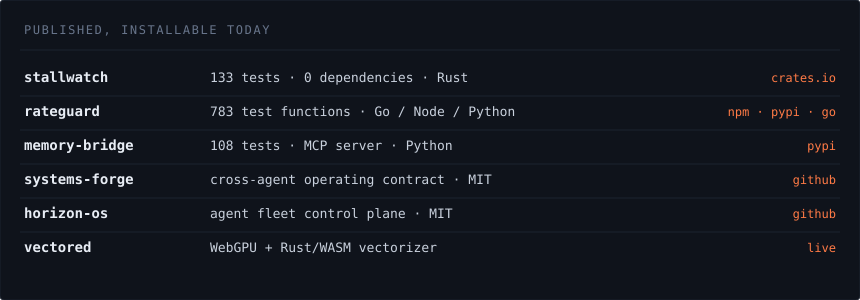

i build the layer underneath agents. budgets, memory, decisions, and the
kernel-level observability that says what actually happened.

small tools that do one thing completely, and that install in one line. i ship
with AI agents and review everything they produce — that habit is why i can
point at 783 passing test functions instead of claiming coverage.

seven months directing a multi-agent workforce that ships production software.
tirupati, india.

[antharmaya.com](https://antharmaya.com) · [harshavar968@gmail.com](mailto:harshavar968@gmail.com)

**[stallwatch](https://github.com/varbees/stallwatch)** — your machine froze and
every monitor says it's fine. reads the pressure data linux already writes and
names the systemd unit, then the process, that stopped you. wakes on kernel
triggers instead of polling, so it costs nothing until something breaks.
rust, zero dependencies, no root. `cargo install stallwatch`

**[rateguard](https://github.com/varbees/rateguard)** — an agent holds your api
key and no sense of when to stop. token budgets, loop detection and circuit
breakers enforced inside your process. no proxy, no network hop. one
conformance suite, three sdks. `npm i @varbees/rateguard-node`

**[memory-bridge](https://github.com/antharmaya/mem-bridge)** — every coding
agent starts each task blind. finds every AI conversation already on your disk
and gives them one shared, searchable memory over MCP. `pip install memory-bridge`

**[horizon-os](https://github.com/varbees/horizon-os)** — point it at a folder of
repositories. deploy agents across all of them, watch them work, stop them,
grade what they produced.

**[systems-forge](https://github.com/antharmaya/sys-forge)** — code an agent
writes should survive, not just run. breakers, retries, an MCP server, and a
cross-agent operating contract read by claude code, codex, cursor, cline and
aider alike.

**[photoselect](https://photoselect.space)** — payment-gated gallery delivery for
indian wedding studios. go, postgres, razorpay, 911 commits. shelved on purpose;
the backend is offline on a lapsed bill, not a design failure.

`rust` `go` `typescript` `python` `postgres` `linux` `cgroups` `psi` `systemd`
`mcp` `next.js` `react` `webgpu` `cloudflare workers` `docker`

every graphic here is generated by [`tools/make_assets.py`](tools/make_assets.py)
and committed to this repo. nothing is embedded from a badge or stats service.

those services rate-limit, go down, change their rendering without telling you,
and see the traffic of everyone who visits. a page that opens by claiming i care
about dependencies should not have ten of them above the fold.

the numbers in the panel are checked before they are written: test counts by
running the suites, versions against crates.io, npm and pypi. a stale one is a
bug, not a rounding.
